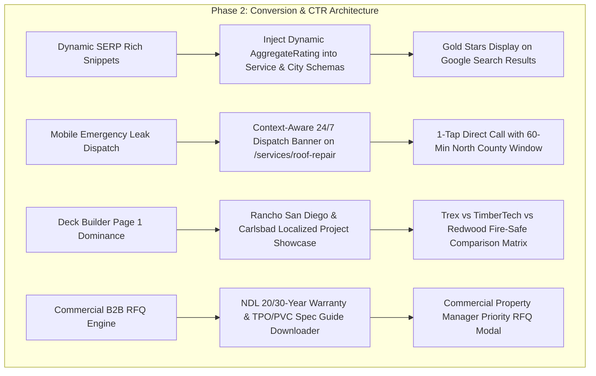
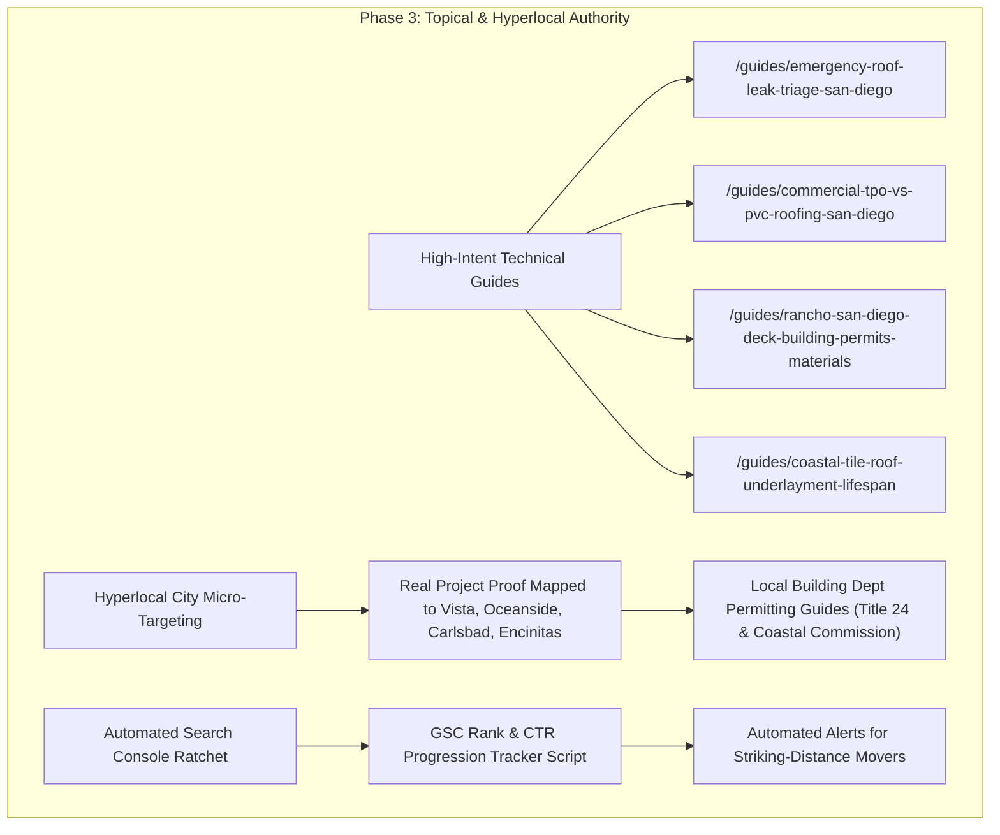

# Phase 2 & Phase 3 Master Strategic Plan: CTR Maximization & Page 1 Dominance

> [!IMPORTANT]
> **Core Objective**: Transform over **22,000 monthly search impressions** currently sitting on Google Pages 2–4 into high-converting Page 1 organic clicks and paying roofing/construction contracts across San Diego County.

---

## Executive Scorecard & Data Grounding (October 11 Baseline)

| Content Cluster | Current Impressions | Current Avg Position | Page 1 Striking Queries | Primary Bottleneck |
| :--- | :---: | :---: | :--- | :--- |
| **Deck & Outdoor Living** | 3,298 | 19.2 | **`deck builder rancho san diego` (Pos 7.8, 661 impr, 0 clicks!)**<br>`deck builder carlsbad` (Pos 10.9, 153 impr)<br>`deck builder descanso` (Pos 12.4, 126 impr) | **0% CTR on Page 1 ranking** due to lack of localized material/pricing cues and fire-safe WUI certifications. |
| **Roof Repair & Leaks** | 3,570 | 26.9 | **`roof leak repair` (Pos 9.2, 55 impr, 0 clicks!)**<br>`emergency roof repair san diego` (Pos 22.8, 130 impr)<br>`roof leak repair san diego` (Pos 25.0, 85 impr) | Mobile searchers facing active leaks need **immediate 1-tap phone dispatch**, not generic forms. |
| **Commercial & Industrial** | 7,118 | 30.9 | `industrial roofing services` (Pos 17.2, 558 impr)<br>`warehouse roof repair` (Pos 14.9, 53 impr)<br>`manufacturing facility roof repair` (Pos 14.4, 77 impr) | Lacks commercial specification depth (TPO/PVC/BUR), NDL warranties, and B2B RFQ capture. |
| **Hyperlocal City Areas** | 8,201 | 18.6 | `oceanside roofing` (Pos 18.1, 1,525 impr)<br>`carlsbad roofing` (Pos 16.3, 986 impr)<br>`encinitas roofers` (Pos 17.3, 818 impr)<br>`vista roofing company` (Pos 20.4, 798 impr) | Striking distance of Page 1; needs localized project proof and Google **SERP Gold Star Review Snippets**. |

---

# PHASE 2: Interactive Conversion Architecture & Mobile CTR Captures
*Goal: Capture immediate clicks on Page 1 rankings and turn mobile/commercial traffic into high-intent inbound leads.*



### 1. Dynamic SERP Rich Snippet Injection (All Services & Cities)
* **Problem**: Even when ranking in top positions, competitors with Google star ratings steal clicks.
* **Architecture**:
  * Update `buildServiceJsonLd` and `buildLocalBusinessJsonLd` in [`website/lib/seo/metadata.ts`](file:///a:/Riseup%20Roofing%20Main%20Dir/website/lib/seo/metadata.ts) to receive `stats: ReviewStats`.
  * Calculate dynamic `AggregateRating`:
    ```json
    "aggregateRating": {
      "@type": "AggregateRating",
      "ratingValue": stats.averageRating.toFixed(1),
      "reviewCount": stats.totalCount,
      "bestRating": "5",
      "worstRating": "1"
    }
    ```
  * Automatically updates on Google Search as new reviews are ingested into PostgreSQL.

### 2. Mobile Emergency Leak Dispatch Architecture (Pos 9.2 CTR Unlock)
* **Problem**: `roof leak repair` ranks at **Pos 9.2** with zero clicks because mobile users with dripping ceilings need immediate reassurance of emergency dispatch.
* **Architecture**:
  * In [`website/app/(marketing)/services/[slug]/page.tsx`](file:///a:/Riseup%20Roofing%20Main%20Dir/website/app/(marketing)/services/[slug]/page.tsx), when viewing `roof-repair` or `roof-inspection`:
    * Render an **Emergency Storm Response Bar** above the fold:
      * Pulsing status badge: `"24/7 Active Storm Leak Dispatch • 60-Min North County Response"`
      * Primary CTA: Prominent 1-tap Click-to-Call `tel:+17606221230` with `"Direct Emergency Roofer"`
      * Secondary CTA: `"Send Photos for 15-Min Triage"`
    * Add infrared/thermal camera leak detection diagnostic section with proof of non-invasive diagnostics.

### 3. Deck Builder Page 1 Capture (`deck builder rancho san diego` Pos 7.8)
* **Problem**: 661 impressions at **Pos 7.8 (Page 1!)** but 0 clicks.
* **Architecture**:
  * Expand [`website/lib/data/services.ts`](file:///a:/Riseup%20Roofing%20Main%20Dir/website/lib/data/services.ts) `deck-builder` content:
    * **Localized Anchor**: Dedicated section for *"Rancho San Diego, Carlsbad & Coastal Custom Decks"*.
    * **Material Comparison Matrix**: Trex Transcend vs TimberTech AZEK vs California Redwood vs MoistureShield (UV resistance, slip resistance, splinter-free durability).
    * **Wildfire WUI Compliance**: Highlighting Class A fire-rated decking materials and metal substructure framing required in East County and hillside communities.
    * **Dual License Advantage**: Explaining how having both C-39 Roofing and B General Building licenses allows integrated waterproofing of second-story walk-out decks over living spaces.

### 4. Commercial B2B RFQ Engine (7,118 Commercial Impressions)
* **Problem**: Commercial facility managers and HOA board members search for technical reliability (warranties, Title 24, minimal tenant disruption).
* **Architecture**:
  * On `/services/commercial-roofing` and `/services/industrial-roofing`:
    * Embed an interactive **Commercial Specification Matrix** (TPO 60-mil vs PVC 80-mil vs Carlisle FleeceBACK vs Silicone Roof Coatings).
    * Add **"Download Commercial NDL Warranty & Spec Guide"** lead capture.
    * Add direct B2B RFQ form with roof square footage, tenant occupancy status, and scheduled maintenance requirements.

---

# PHASE 3: Topical Authority Dominance & Local Map Pack Expansion
*Goal: Push striking queries from Page 2–3 (Pos 11–25) into Top 3 / Top 5 Google Search & Google Maps Local Pack.*



### 1. Four High-Intent Topical Authority Guides (Targeting Keyword Clusters)
Each guide will be a deep technical resource (1,500+ words, diagrams, FAQs, JSON-LD Article Schema) designed to rank for high-impression query clusters:

1. **`emergency-roof-leak-triage-san-diego`**:
   * *Target Queries*: `emergency roof leak repair`, `ceiling leak mitigation`, `roof leak insurance claim san diego`.
   * *Content*: Step-by-step homeowner protocol during a rainstorm (containment, electrical safety, ceiling relief holes, photographic evidence for adjusters).
   * *Direct Internal Link*: Links directly to `/services/roof-repair`.
2. **`commercial-tpo-vs-pvc-roofing-san-diego`**:
   * *Target Queries*: `industrial roofing services`, `commercial flat roof replacement`, `tpo roofing contractor san diego`.
   * *Content*: Thermal emissivity, California Title 24 Cool Roof standards, restaurant grease resistance (PVC) vs warehouse solar reflectivity (TPO).
   * *Direct Internal Link*: Links directly to `/services/commercial-roofing` and `/services/industrial-roofing`.
3. **`rancho-san-diego-deck-building-permits-materials`**:
   * *Target Queries*: `deck builder rancho san diego`, `deck builder descanso`, `san diego county deck permits`.
   * *Content*: County of San Diego building permit exemptions vs requirements, wildfire brush clearance zones, Trex fire ratings.
   * *Direct Internal Link*: Links directly to `/services/deck-builder`.
4. **`coastal-tile-roof-underlayment-lifespan`**:
   * *Target Queries*: `tile roof relay oceanside`, `carlsbad tile underlayment replacement`, `tile roof leak repair`.
   * *Content*: Why 25-year tile underlayment fails prematurely under coastal sun, synthetic vs two-ply modified bitumen SBS (torch-down/peel-and-stick).
   * *Direct Internal Link*: Links directly to `/services/tile-roofing` and `/projects/carlsbad-tile-relayment`.

### 2. Hyperlocal City Micro-Targeting (Top 4 City Hubs)
* **Target Cities**: Oceanside (1,525 impr), Carlsbad (986 impr), Encinitas (818 impr), Vista (798 impr).
* **Architecture**:
  * Cross-link verified customer reviews to their matching city page (e.g. T Hobart & Rosanna Cesena displayed prominently on `/service-area/oceanside`; Damian Diaz on `/service-area/carlsbad`).
  * Add localized architectural context (e.g. Oceanside beach cottages and coastal salt air, Carlsbad custom Spanish tile relays, Encinitas solar-roof integrations).
  * Embed localized Google Maps Directions link for geographic entity reinforcement.

### 3. Automated Search Console Rank & CTR Monitoring Ratchet
* **Tool**: `scripts/gsc_performance_ratchet.py`
  * Compares latest Search Console CSV exports against our Oct 11 baseline.
  * Tracks query migration: Page 3 $\rightarrow$ Page 2 $\rightarrow$ Page 1 $\rightarrow$ Top 3.
  * Identifies queries with high impressions (>100) and CTR < 2% for immediate title tag refinement.

---

## Phased Execution Roadmap

```
┌─────────────────────────────────────────────────────────────┐
│ PHASE 1: Quick-Wins & Review System (COMPLETED & LIVE)     │
│ ✔ CTR Title & Description Rewrites Deployed                 │
│ ✔ Empty Portfolio Bug Resolved                               │
│ ✔ 9 Verified Real Google Reviews Ingested in Prod DB        │
│ ✔ Dynamic Rating Engine & Zero-Quota Hourly Poller Live     │
└──────────────────────────────┬──────────────────────────────┘
                               │
                               ▼
┌─────────────────────────────────────────────────────────────┐
│ PHASE 2: Conversion & Mobile CTR Architecture (READY)       │
│ 1. Dynamic SERP AggregateRating Schema across Services/Cities│
│ 2. Mobile Emergency Leak Dispatch Banner for /roof-repair    │
│ 3. Rancho San Diego Deck Matrix & Localized Portfolio       │
│ 4. Commercial B2B Specification & RFQ Modal                 │
└──────────────────────────────┬──────────────────────────────┘
                               │
                               ▼
┌─────────────────────────────────────────────────────────────┐
│ PHASE 3: Topical Authority & Local Pack Dominance (PLANNED) │
│ 1. 4 High-Intent Pillar Guides (Leak, TPO, Deck, Tile)      │
│ 2. Hyperlocal City Hubs with Mapped Reviews & Projects      │
│ 3. Automated GSC Performance Ratchet & Rank Tracking        │
└─────────────────────────────────────────────────────────────┘
```

---

## Verification & Guardrail Checklist

- [ ] **Dynamic Ratings Only**: No hardcoded star numbers anywhere.
- [ ] **Zero API Exhaustion**: Hourly review poller uses count-check first.
- [ ] **Clean TypeScript Build**: 88/88 static routes compile with zero errors.
- [ ] **Doorway Defense**: Every city page maintains unique local copy, verified projects, and valid NAP.
- [ ] **Zero Premature Deployment**: Code is staged, verified locally, and reviewed with user prior to any production push.
